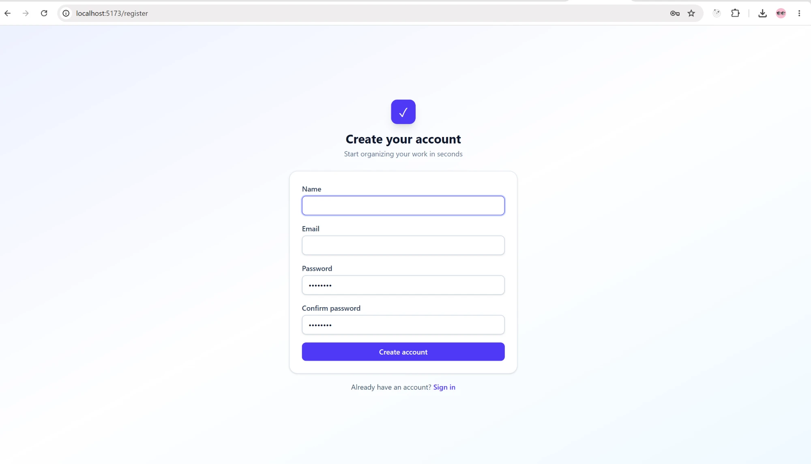
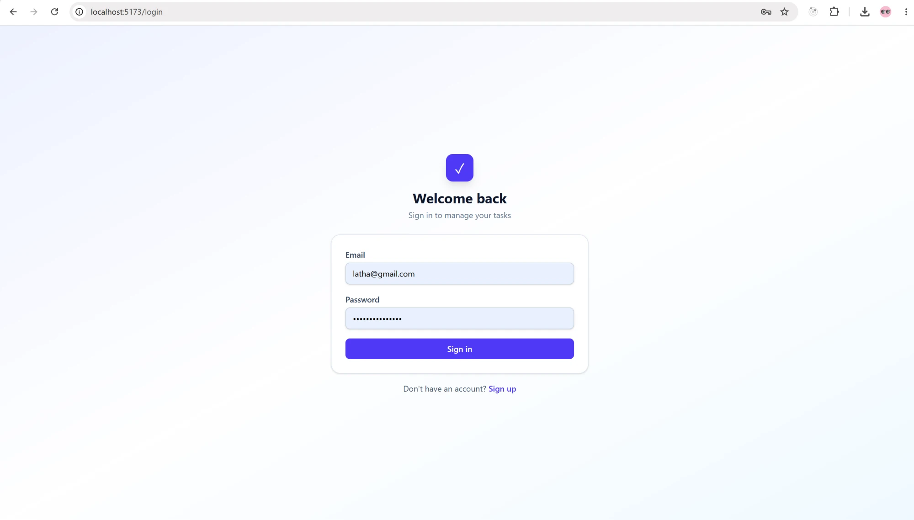
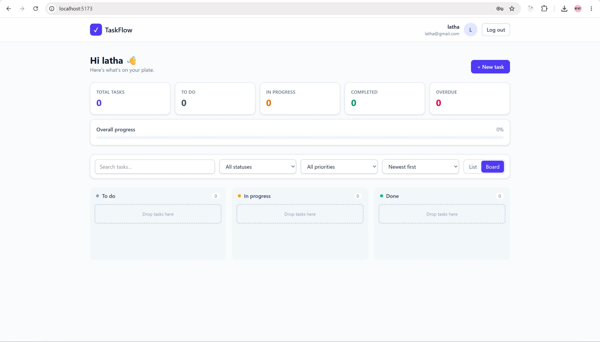
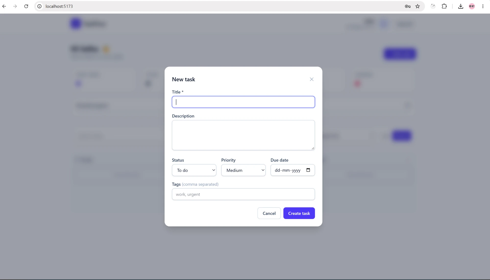

<div align="center">

# ✅ TaskFlow

**A full-stack MERN task management app with JWT authentication, Kanban board, and real-time stats.**

[](https://react.dev)
[](https://tailwindcss.com)
[](https://nodejs.org)
[](https://expressjs.com)
[](https://www.mongodb.com/atlas)
[](https://jwt.io)

### 🔗 [Live Demo](https://your-taskflow-app.vercel.app) &nbsp;·&nbsp; [API](https://your-taskflow-api.onrender.com/api/health)

</div>

---

## 📸 Screenshots

| Register | Login |
|---|---|
|  |  |

| Dashboard (Board view) | Create Task |
|---|---|
|  |  |

---

## ✨ Features

- 🔐 **Authentication**: register and login with JWT, passwords hashed with bcrypt, protected routes, and auto-logout when the token expires
- 📝 **Task CRUD**: title, description, status, priority, due date and tags
- 📋 **List view**: debounced search, status and priority filters, 5 sort options, and pagination
- 🗂️ **Kanban board**: drag-and-drop tasks between *To do*, *In progress* and *Done*
- 📊 **Dashboard stats**: totals per status, overdue count and a progress bar
- ⚡ **Optimistic UI**: instant status changes and one-click complete
- 🛡️ **Security**: Helmet, CORS, rate limiting, input validation, regex escaping, and per-user data isolation
- 📱 **Responsive**: works on mobile, tablet and desktop

---

## 🛠️ Tech Stack

| Layer | Technologies |
|---|---|
| **Frontend** | React 19, Vite, Tailwind CSS v4, React Router, Axios |
| **Backend** | Node.js, Express, Mongoose |
| **Database** | MongoDB Atlas |
| **Auth & Security** | JSON Web Tokens, bcryptjs, express-validator, Helmet, express-rate-limit, CORS |

---

## 🚀 Getting Started

### Prerequisites
- Node.js 18 or newer
- A MongoDB database (free [MongoDB Atlas](https://www.mongodb.com/atlas) cluster, or local MongoDB)

### 1. Clone and install
```bash
git clone https://github.com/<your-username>/task-manager.git
cd task-manager
npm run install:all
```

### 2. Configure environment variables
Create `server/.env` (see `server/.env.example`):
```env
PORT=5000
MONGO_URI=mongodb+srv://<user>:<password>@<cluster>.mongodb.net/task-manager?retryWrites=true&w=majority
JWT_SECRET=<a-long-random-string>
JWT_EXPIRES_IN=7d
CLIENT_URL=http://localhost:5173
```
> In MongoDB Atlas, add your IP under **Security → Network Access** or the connection is refused.

### 3. Run
```bash
npm run dev
```
- Frontend: http://localhost:5173
- API: http://localhost:5000/api

---

## 📡 API Reference

All `/api/tasks` routes require the header `Authorization: Bearer <token>`.

| Method | Endpoint | Description |
|---|---|---|
| `POST` | `/api/auth/register` | Register `{ name, email, password }` |
| `POST` | `/api/auth/login` | Login `{ email, password }` → `{ token, user }` |
| `GET` | `/api/auth/me` | Get current user |
| `GET` | `/api/tasks` | List tasks. Query: `status`, `priority`, `search`, `tag`, `sort`, `page`, `limit` |
| `GET` | `/api/tasks/stats` | Counts per status + overdue |
| `POST` | `/api/tasks` | Create task |
| `GET` | `/api/tasks/:id` | Get a task |
| `PATCH` | `/api/tasks/:id` | Update a task |
| `DELETE` | `/api/tasks/:id` | Delete a task |

---

## 📁 Project Structure

```
task-manager/
├── client/                    # React frontend
│   └── src/
│       ├── api/client.js      # Axios instance + JWT interceptor
│       ├── context/           # AuthContext (global auth state)
│       ├── pages/             # Login, Register, Dashboard
│       └── components/        # TaskCard, TaskForm, BoardView, StatsCards, Modal…
├── server/                    # Express backend
│   └── src/
│       ├── config/db.js       # MongoDB connection
│       ├── models/            # User, Task (Mongoose schemas)
│       ├── controllers/       # Auth + task logic
│       ├── routes/            # Routes + validation rules
│       ├── middleware/        # JWT auth, validation, error handling
│       └── app.js / index.js
└── docs/screenshots/
```

---

## ☁️ Deployment

**Backend → [Render](https://render.com)** (Web Service)
- Root directory: `server` · Build: `npm install` · Start: `npm start`
- Environment: `MONGO_URI`, `JWT_SECRET`, `JWT_EXPIRES_IN`, `NODE_ENV=production`, `CLIENT_URL=<your Vercel URL>`
- In Atlas Network Access, allow `0.0.0.0/0` (Render's free tier has no fixed IP)

**Frontend → [Vercel](https://vercel.com)**
- Root directory: `client` · Framework: Vite
- Environment: `VITE_API_URL=<your Render URL>` (no trailing slash)
- `client/vercel.json` already rewrites all routes to `index.html`, so refreshing `/login` works

Then update the **Live Demo** link at the top of this README.

---

## 🔮 Future Improvements

- Refresh tokens and httpOnly cookies
- Unit and integration tests (Jest, Supertest, React Testing Library)
- Team workspaces and task assignment
- Real-time updates with Socket.io
- Email reminders for due dates
- Dark mode

---

## 👤 Author

**Karthik Raju**
- GitHub: [@your-username](https://github.com/your-username)
- LinkedIn: [your-profile](https://linkedin.com/in/your-profile)

⭐ If you found this project useful, give it a star!
